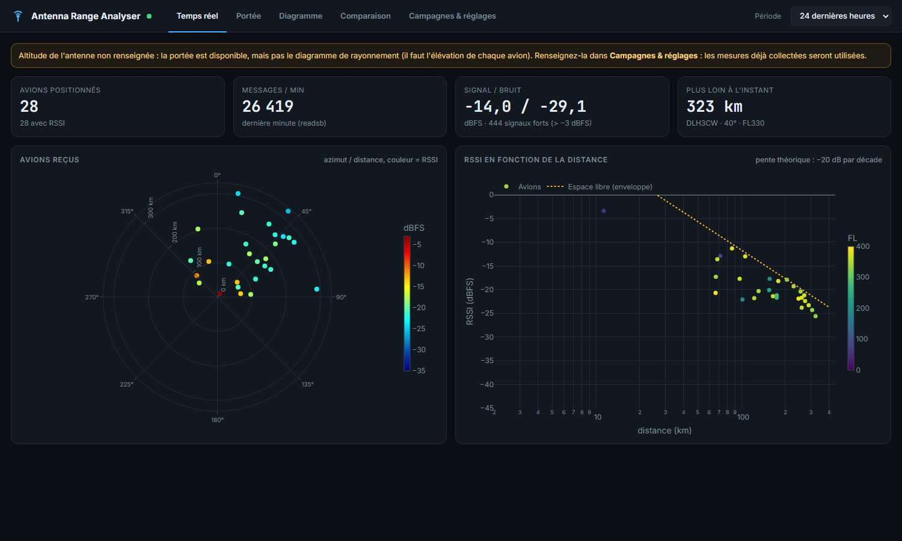

# 📡 Antenna Range Analyser for ADS-B

Mesurez **le diagramme de rayonnement réel** et **la portée** de votre antenne ADS-B à partir des avions que vous recevez, puis
comparez deux installations : antenne seule, avec déflecteur, plus haute, autre câble…

L'outil tourne à côté de `readsb` (image ADSBexchange, piaware, adsb.im…). Il n'utilise que les données du récepteur, sans
matériel ni service externe, et les affiche dans une page web en temps réel.


---

## Ce que l'on obtient

| Onglet | Contenu |
|---|---|
| **Temps réel** | Avions reçus (azimut, distance, RSSI), messages par minute, signal et bruit, RSSI en fonction de la distance avec la pente théorique d'espace libre |
| **Portée** | Portée par azimut : maximum, 95e centile, médiane, par tranche d'altitude ; horizon radio théorique ; meilleur et plus faible secteur |
| **Diagramme** | Diagramme de rayonnement **mesuré** : plan horizontal, plan vertical (selon l'élévation) et **diagramme 3D** |
| **Comparaison** | Deux campagnes ou périodes superposées : écart de gain (dB) et de portée (km) par azimut |
| **Campagnes & réglages** | Démarrer ou arrêter une campagne de mesure par configuration d'antenne ; altitude de l'antenne ; probabilité de détection (option) |



---

## Méthode

Pour chaque avion, `readsb` fournit la distance et le relèvement depuis le récepteur (`r_dst`, `r_dir`), l'altitude et la
puissance reçue (`rssi`, en dBFS). Toutes les 10 s, l'outil enregistre une mesure par avion.

**Portée** : la distance des avions reçus, regroupée par secteur de 5°. Le 95e centile est plus fiable que le maximum, qui
dépend d'un seul avion exceptionnel. L'horizon radio théorique (rayon terrestre « radio », k = 4/3) sert de référence :

```
d_horizon (km) ≈ 4,12 × (√h_antenne + √h_avion)      hauteurs en mètres
```

**Diagramme de rayonnement** : la puissance reçue vaut

```
RSSI = P_transpondeur + G_avion + G_antenne(azimut, élévation) − FSPL(d) − pertes
FSPL = 20 log10(d_km) + 20 log10(1090) + 32,44 dB
```

L'**indice de gain** `RSSI + FSPL` ne dépend donc plus que du gain de votre antenne dans la direction de l'avion, de la
puissance propre de son transpondeur et d'une constante. Avec des milliers de mesures sur des centaines d'avions, la
puissance des transpondeurs se moyenne. L'outil retire en plus la part propre à chaque avion par **moindres carrés alternés**
(`mesure = G(direction) + P(avion)`, P centrée sur 0) : le diagramme est plus net et le niveau absolu est conservé, ce qui
permet de comparer deux campagnes.

L'élévation de chaque avion est calculée avec la courbure terrestre et la réfraction standard, à partir de l'altitude de
l'antenne que vous renseignez. Elle est recalculée à chaque analyse : corriger l'altitude s'applique aussi au passé.

### Limites à connaître

- **Biais de détection** : aux grandes distances, seuls les signaux assez forts sont décodés, ce qui surestime un peu le gain
  aux très basses élévations.
- **Saturation** : au-dessus de −3 dBFS, le RSSI ne mesure plus rien ; ces points sont écartés. Beaucoup de « signaux forts »
  dans l'onglet Temps réel signalent un gain de réception trop élevé.
- **Couverture du ciel** : les directions sans trafic (pas de couloir aérien, relief) restent vides. Chaque case affichée
  réunit au moins 5 mesures (médiane).
- **Comparaisons** : le trafic change selon l'heure et le jour. Comparez des campagnes de durée et d'horaires proches, sur
  plusieurs heures.
- C'est une mesure **relative** sur données réelles, pas une mesure en chambre anéchoïque.

---

## Comparer deux installations (exemple : ajout d'un déflecteur)

1. Onglet **Campagnes** : démarrez la campagne « dipôle seul ». Laissez tourner quelques heures, idéalement une journée.
2. Arrêtez-la, installez le déflecteur, démarrez la campagne « avec déflecteur » pour une durée et des horaires comparables.
3. Onglet **Comparaison** : A = « dipôle seul », B = « avec déflecteur ». Vous lisez l'écart de gain en dB et l'écart de portée
   en km par azimut : gain vers l'avant, perte vers l'arrière, effet sur la portée.

Les mesures d'une campagne sont conservées sans limite de durée. Les autres sont purgées après 7 jours (réglable).

---

## Installation

Prérequis : `readsb` (qui écrit `/run/readsb/aircraft.json`), Python 3.7 ou plus récent, `numpy`.

```bash
git clone https://github.com/DRSEE/antenna-range-analyser-for-adsb.git ~/antenna-range-analyser
cd ~/antenna-range-analyser
cp config.example.json config.local.json      # puis renseigner antenna_alt_m
python3 run.py                                # http://<ip-du-pi>:5002
```

En service :

```bash
sudo cp antenna-range-analyser.service /etc/systemd/system/
sudo systemctl enable --now antenna-range-analyser
```

Au démarrage, l'historique récent de tar1090 (`/run/tar1090`, positions sans RSSI) est importé : la carte de portée est
remplie tout de suite. Le diagramme de rayonnement se construit ensuite en temps réel.

### Configuration (`config.local.json`, non versionné)

| Clé | Rôle | Défaut |
|---|---|---|
| `antenna_alt_m` | Altitude de l'antenne (sol + mât), en mètres au-dessus de la mer | à renseigner |
| `geoid_offset_m` | Écart entre altitude GNSS (WGS84) et altitude ; environ 50 m en France | 0 |
| `sample_interval_s` | Une mesure par avion toutes les N secondes | 10 |
| `retention_days` | Conservation des mesures hors campagne | 7 |
| `port` | Port de la page web | 5002 |
| `reference.enabled` | Probabilité de détection à partir d'un réseau communautaire (voir ci-dessous) | `false` |

La position de la station n'est jamais écrite dans le dépôt : elle est lue au besoin dans `receiver.json` de `readsb`.

### Probabilité de détection (option)

Si `reference.enabled` vaut `true`, l'outil interroge chaque minute un réseau communautaire (par défaut `api.adsb.lol`) pour
connaître les avions présents autour de la station, puis regarde lesquels votre récepteur entend. Vous obtenez le pourcentage
d'avions détectés selon la distance. **Cette requête transmet la position de la station au service interrogé** : c'est
pourquoi l'option est désactivée par défaut.

---

## API

| Route | Contenu |
|---|---|
| `GET /api/live` | Avions reçus à l'instant, statistiques readsb |
| `GET /api/range?campaign=<id \| h24>&band=all\|low\|mid\|high` | Portée par azimut |
| `GET /api/pattern?campaign=…&el_lo=0&el_hi=10&az=&half=30&correct=1` | Diagramme : grille 3D, plans horizontal et vertical |
| `GET /api/compare?a=…&b=…` | Comparaison de deux campagnes ou périodes |
| `GET /api/detection?campaign=…` | Probabilité de détection (référence externe) |
| `GET/POST /api/campaigns` | Liste, démarrage, arrêt, suppression des campagnes |

## Tests

```bash
python3 -m unittest discover tests
```

Le test de diagramme simule une antenne avec un lobe de +6 dB et des transpondeurs de puissances différentes (±5 dB), et
vérifie que la correction par avion retrouve le lobe.

## Licence

MIT, voir [LICENSE](LICENSE).
