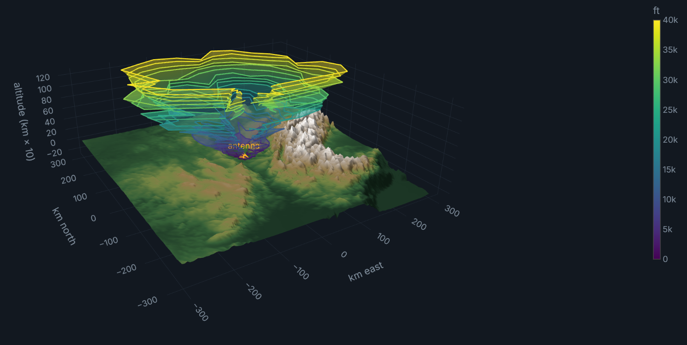
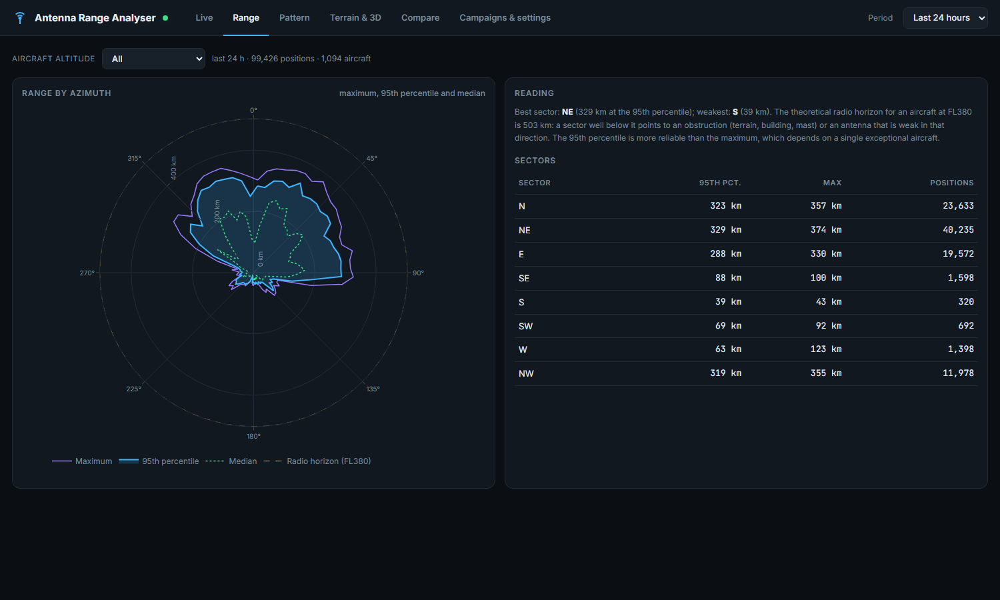

# 📡 Antenna Range Analyser for ADS-B

Measure the **real radiation pattern** and **range** of your ADS-B antenna from the aircraft you actually receive, then compare
two installations: bare antenna, with a reflector, mounted higher, different cable…

It runs next to `readsb` (ADSBexchange image, piaware, adsb.im…). Measurements come only from your receiver, with no extra
hardware, and are shown in a live web page. Optionally, open terrain data tells you whether a blind sector is caused by a
mountain or by something right next to the antenna.



---

## What you get

| Tab | Content |
|---|---|
| **Live** | Received aircraft (azimuth, distance, RSSI), messages per minute, signal and noise, RSSI versus distance with the free-space slope |
| **Range** | Range by azimuth: maximum, 95th percentile, median, per altitude band; theoretical radio horizon; best and weakest sector |
| **Pattern** | **Measured** radiation pattern: horizontal plane, vertical plane (versus elevation) and **3D pattern** |
| **Terrain & 3D** | 3D coverage volume over the terrain; measured horizon mask versus terrain mask; per-sector diagnosis (terrain or local obstruction); RF profile of an azimuth with grazing ray and first Fresnel zone |
| **Compare** | Two campaigns or periods overlaid: gain difference (dB) and range difference (km) by azimuth |
| **Campaigns & settings** | Start or stop a measurement campaign per antenna setup; antenna altitude; detection probability (optional) |



---

## Method

For every aircraft, `readsb` provides the distance and bearing from the receiver (`r_dst`, `r_dir`), the altitude and the received
power (`rssi`, in dBFS). Every 10 s the tool stores one sample per aircraft.

**Range**: distance of received aircraft, grouped in 5° sectors. The 95th percentile is more reliable than the maximum, which
depends on a single exceptional aircraft. The theoretical radio horizon (radio Earth radius, k = 4/3) is the reference:

```
d_horizon (km) ≈ 4.12 × (√h_antenna + √h_aircraft)      heights in metres
```

**Radiation pattern**: the received power is

```
RSSI = P_transponder + G_aircraft + G_antenna(azimuth, elevation) − FSPL(d) − losses
FSPL = 20 log10(d_km) + 20 log10(1090) + 32.44 dB
```

The **gain index** `RSSI + FSPL` therefore only depends on your antenna's gain towards the aircraft, the aircraft's own
transponder power and a constant. Over thousands of samples from hundreds of aircraft, transponder power averages out. The tool
also removes each aircraft's own contribution by **alternating least squares** (`sample = G(direction) + P(aircraft)`, P centred on
0): the pattern is sharper and the absolute level is kept, so two campaigns can be compared.

Each aircraft's elevation is computed with Earth curvature and standard refraction, from the antenna altitude you enter. It is
recomputed at every analysis: correcting the altitude also applies to past samples.

**Horizon mask and terrain**: in each direction, the lowest elevation at which aircraft are still received (2nd percentile) traces
whatever blocks the signal. It is compared with the mask **predicted from terrain**: highest terrain angle seen from the antenna,
curvature and refraction included, with the responsible ridge (distance, altitude).

- measured mask ≈ terrain mask: it is the mountain;
- measured mask clearly higher (more than 1°): **local obstruction** (building, roof, wall, mast) that terrain does not explain.

The **RF profile** of an azimuth shows terrain as apparent height (curvature removed, so radio waves travel in straight lines), the
grazing ray that touches the highest obstacle, the first Fresnel zone (`17.3 √(d₁d₂ / (f·d))` m) and every aircraft received in
that direction.

### Limits

- **Detection bias**: at long range only strong enough signals are decoded, which slightly overestimates the gain at very low
  elevations.
- **Saturation**: above −3 dBFS RSSI no longer measures anything; those samples are dropped. Many "strong signals" in the Live tab
  suggest the receiver gain is too high.
- **Sky coverage**: directions without traffic (no airway, terrain) stay empty. Each displayed cell holds at least 5 samples
  (median).
- **Comparisons**: traffic depends on time and day. Compare campaigns of similar length and time of day, over several hours.
- This is a **relative** measurement on real-world data, not an anechoic-chamber measurement.

---

## Comparing two installations (example: adding a reflector)

1. **Campaigns** tab: start the "bare dipole" campaign. Let it run a few hours, ideally a full day.
2. Stop it, fit the reflector, start the "with reflector" campaign for a similar duration and time of day.
3. **Compare** tab: A = "bare dipole", B = "with reflector". You read the gain difference in dB and the range difference in km by
   azimuth: gain to the front, loss to the back, effect on range.

Samples belonging to a campaign are kept with no time limit. Other samples are purged after 7 days (configurable).

---

## Installation

Requirements: `readsb` (writing `/run/readsb/aircraft.json`), Python 3.7 or newer, `numpy`; `Pillow` for terrain.

```bash
git clone https://github.com/DRSEE/antenna-range-analyser-for-adsb.git ~/antenna-range-analyser
cd ~/antenna-range-analyser
cp config.example.json config.local.json      # then set antenna_alt_m
python3 run.py                                # http://<pi-ip>:5002
```

As a service:

```bash
sudo cp antenna-range-analyser.service /etc/systemd/system/
sudo systemctl enable --now antenna-range-analyser
```

On start-up, recent tar1090 history (`/run/tar1090`, positions without RSSI) is imported, so the range map is filled straight
away. The radiation pattern then builds up live.

### Configuration (`config.local.json`, not versioned)

| Key | Purpose | Default |
|---|---|---|
| `antenna_alt_m` | Antenna altitude (ground + mast), metres above sea level | to set |
| `geoid_offset_m` | Difference between GNSS (WGS84) altitude and altitude; about 50 m in France | 0 |
| `sample_interval_s` | One sample per aircraft every N seconds | 10 |
| `retention_days` | Retention of samples outside campaigns | 7 |
| `port` | Web page port | 5002 |
| `reference.enabled` | Detection probability from a community network (see below) | `false` |

The station position is never written in the repository: it is read when needed from `readsb`'s `receiver.json`.

### Terrain (optional, on demand)

The **Load terrain** button (Terrain & 3D tab) downloads about fifty elevation tiles once from the open
[AWS Terrain Tiles](https://registry.opendata.aws/terrain-tiles/) dataset (Terrarium format, zoom 8, ≈ 400 m per pixel), about
300 km around the station. They are kept in `data/terrain/`. **The service sees the area downloaded**; nothing else is sent.

### Detection probability (optional)

When `reference.enabled` is `true`, the tool queries a community network (`api.adsb.lol` by default) every minute for the aircraft
around the station, then checks which ones your receiver hears. You get the share of aircraft detected versus distance. **This
request sends the station position to the queried service**, which is why the option is off by default.

---

## API

| Route | Content |
|---|---|
| `GET /api/live` | Aircraft received right now, readsb statistics |
| `GET /api/range?campaign=<id \| h24>&band=all\|low\|mid\|high` | Range by azimuth |
| `GET /api/pattern?campaign=…&el_lo=0&el_hi=10&az=&half=30&correct=1` | Pattern: 3D grid, horizontal and vertical planes |
| `GET /api/compare?a=…&b=…` | Comparison of two campaigns or periods |
| `GET /api/coverage3d?campaign=…` | Coverage volume (azimuth × altitude) and measured horizon mask |
| `GET /api/terrain` · `POST /api/terrain` | Terrain mask and 3D grid · start the terrain download |
| `GET /api/profile?az=…&campaign=…` | RF profile: terrain, received aircraft and lower envelope along an azimuth |
| `GET /api/detection?campaign=…` | Detection probability (external reference) |
| `GET/POST /api/campaigns` | List, start, stop, delete campaigns |

## Tests

```bash
python3 -m unittest discover tests
```

The pattern test simulates an antenna with a +6 dB lobe and transponders of different power (±5 dB), and checks that the
per-aircraft correction recovers the lobe.

## Licence

MIT, see [LICENSE](LICENSE).
